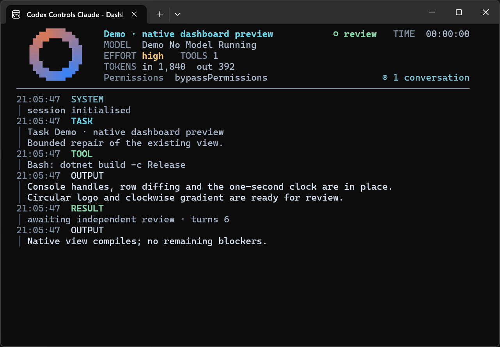
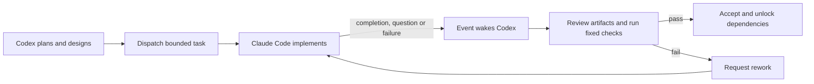

<div align="center">


# Codex Controls Claude

**Codex plans. Claude Code builds. Codex checks the work.**

A local Codex plugin for supervising Claude Code with your configured model and tools. Codex breaks work into bounded tasks, delegates implementation, waits for actionable events, and independently runs the acceptance checks before unlocking dependent work.

[Install](#install) · [First task](#first-task) · [Dashboard](#worker-dashboard) · [How it works](#how-it-works) · [Development and testing](docs/testing.md)

</div>

## Requirements

| Requirement | Where it applies |
|---|---|
| Codex with plugin support | The supervisor and bundled skills |
| Node.js 22+ | Local MCP server; dependencies are bundled for normal use |
| Claude Code | Installed locally, with working native authentication or gateway configuration |
| Windows Terminal and .NET 10 runtime | Native Windows worker dashboard; SIXEL enables the pixel logo |

Claude Code manages shell selection through its native settings. When its PowerShell tool is enabled, it is the primary shell and prefers PowerShell 7 (`pwsh.exe`), with Windows PowerShell 5.1 as a fallback. The worker inherits your existing shell configuration. See the [Claude Code PowerShell documentation](https://code.claude.com/docs/en/tools-reference#powershell-tool).

Building the native helper requires the **.NET 10 SDK**; running the shipped helper requires only its runtime.

## Install

Add the marketplace, then install the plugin:

```bash
codex plugin marketplace add Ultmebius/codex-controls-claude
codex plugin add codex-controls-claude@codex-controls-claude
```

You can also open `/plugins` in Codex, choose the **codex-controls-claude** marketplace and install from there. Start a fresh chat after installation so its MCP connection and skills load.

For a local checkout:

```bash
git clone https://github.com/Ultmebius/codex-controls-claude.git
cd codex-controls-claude
codex plugin marketplace add .
codex plugin add codex-controls-claude@codex-controls-claude
```

Activation is explicit: name **Codex Controls Claude** or invoke its `orchestrate` skill. Generic coding requests do not automatically start a worker. Authorized follow-ups continue the existing run.

## First task

Open a small project and send Codex a concrete request, for example:

> Use Codex Controls Claude to add a CSV summary command to this project. Read the code first, define acceptance checks, delegate implementation to Claude Code, and independently verify the resulting files and checks.

A successful run gives you a task plan, a Claude Code worker, actual changed files, and acceptance results. On Windows the worker has its own terminal, which starts minimized and can be restored to inspect activity. A worker saying it finished is followed by Codex reviewing the artifacts and running the fixed checks.

For work that can run independently:

> Use Codex Controls Claude to fix the parser and update its documentation in parallel where their write scopes do not overlap. Gate integration on independent checks, and report the final diff and results.

Codex chooses a single run or a team according to the work. See [usage and recovery](docs/usage.md) for task contracts, questions, guidance, budgets and session continuity.

## Worker dashboard



*An actual Windows Terminal capture in demonstration mode. Model, token and task values in this image are synthetic; it demonstrates the renderer and the public default logo.*

The dashboard shows the reported model, effort, native permissions, tool count, elapsed time, cumulative conversation tokens and streaming output. It supports terminal Markdown, scrolling, text selection and copying. A `~` marks a partly estimated token count; `—` marks a value the runtime has not reported.

The circular logo cycles clockwise through Codex blue, Claude red and the shades between them. It uses cached animation frames and pauses while minimized. Terminals without SIXEL use a half-block fallback. Thinking blocks stay out of the dashboard, and displayed fields are sanitized. See [dashboard controls and accounting](docs/dashboard.md) for the complete interaction and rendering behavior.

## How it works



| Capability | Behavior |
|---|---|
| Independent acceptance | Original executable checks, revisions and artifact hashes gate acceptance |
| Event-driven supervision | A pending wait wakes for decisions or results; ordinary milestones remain in the audit |
| Parallel work | Up to three managed executions across connected chats, with dependency and write-scope scheduling |
| Mid-task guidance | Queue additions at the next turn boundary, deliberately interrupt, or answer a worker question |
| Persistent work | Resume saved conversations, recover released owners, and keep checkpoints and budget accounting |
| Native tools and permissions | Claude Code uses its own enabled tools, MCP servers, hooks and permission settings |

A task contract declares its artifacts, dependencies and immutable checks. Replacing a task rewires dependents to the replacement's own contract. Technical completion retains the candidate for your review; user approval is a separate step. Detailed limits and lifecycle rules are in [usage](docs/usage.md).

## Model, permissions and state

The worker reads `env.ANTHROPIC_MODEL` from `~/.claude/settings.json` first, then the environment or top-level `model`, otherwise Claude Code's native default. Your settings file is not modified. Existing warm sessions keep their startup model; a new session boundary applies a changed configuration.

Claude Code's effective permission mode, hooks, enabled MCP servers and allow/deny/ask rules remain in charge of tool execution. Native questions reach Codex through the supervisor bridge. `writeScope` reserves paths for scheduling and auditing; it is not an OS sandbox. Native subagents follow your own Claude Code policies.

State uses `PLUGIN_DATA` when supplied by the host, then `CCC_DATA_DIR`, otherwise `~/.local/share/codex-controls-claude`. This retains task ledgers and recovery evidence. Claude Code also maintains its native conversation transcripts. See [configuration and continuity](docs/usage.md#configuration).

## Tools

The local `claude-orchestrator` MCP exposes ten tools:

| Tool | Purpose |
|---|---|
| `orchestrator_plan` | Plans, task contracts, recovery and session lifecycle |
| `orchestrator_dispatch` | Start dependency-ready work |
| `orchestrator_wait` | Wait for an actionable event, up to 20 minutes |
| `orchestrator_review` | Check current artifacts and rerun the original checks |
| `orchestrator_status` | Retrieve targeted result, check, budget and recovery evidence |
| `orchestrator_message` | Queue guidance, interrupt a turn or answer a question |
| `orchestrator_respond_permission` | Answer a residual native permission request |
| `orchestrator_cancel` | Stop a run without disturbing peers |
| `orchestrator_team` | Schedule dependency-linked workers and manage their shared lifecycle |
| `orchestrator_doctor` | Inspect local configuration without a model call |

## Troubleshooting

| Symptom | Next step |
|---|---|
| Tools are missing | Confirm the plugin is enabled and its MCP launches, then reopen the chat |
| Health check passes but work fails | A doctor result proves configuration; use a disposable task to test actual inference |
| `WORKER_SLOTS_FULL` | Wait for an owned execution to finish; idle retained transcripts use no execution slot |
| An empty wait returns | Continue waiting with the returned cursor; do not replace it with status polling |
| Logo appears as blocks | The half-block fallback is active because SIXEL is unavailable |
| Updated code is not active | Reconnect the plugin or restart Codex; existing workers keep their loaded version |

From a checkout, `node scripts/doctor.mjs` provides the same configuration diagnostic. It does not certify model inference. [Testing](docs/testing.md) describes automated checks and the separate real-model/desktop acceptance procedure.

## Development and provenance

The public repository includes maintained source, the shared engine's regression suite and pinned development dependencies. See [development and testing](docs/testing.md) for setup, builds and runtime export, and the [changelog](CHANGELOG.md) for version history. Git marketplace checkouts include tracked development files; the documented runtime export uses an explicit file list.

Execution and session functionality derives from [xihuai18/claude-code-mcp](https://github.com/xihuai18/claude-code-mcp) at commit [`47aa47b4`](https://github.com/xihuai18/claude-code-mcp/tree/47aa47b4f7f02f5dd5c6bc9174d30a42f54484f2) (MIT). The Claude Agent SDK query consumer, session lifecycle, executable selection and permission normalization come from there. The Codex task ledger, event subscriptions, independent acceptance gate, local process ownership, native terminal dashboard and plugin packaging are built on top of it.

Bundled dependency licenses are reproduced in [THIRD_PARTY_NOTICES.md](THIRD_PARTY_NOTICES.md), and the worker policy inventory lives in [skills/orchestrate/references/worker-policy.md](skills/orchestrate/references/worker-policy.md).

Licensed under [MIT](LICENSE).
