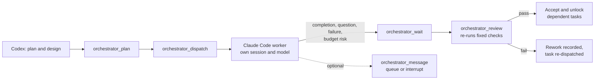

<div align="center">


# Codex Controls Claude

**Codex plans. C​laude Code builds. Codex checks the work.**

A local Codex plugin that turns C​laude Code into a supervised implementation worker: Codex designs the plan, dispatches bounded tasks to C​laude Code with your own model, waits on real events instead of polling, and independently re-runs the acceptance checks before it unlocks anything downstream.

[Install](#install) · [How it works](#how-it-works) · [Dashboard](#worker-dashboard-windows) · [Tools](#tools) · [Permissions](#permissions-and-safety) · [Requirements](#requirements) · [Troubleshooting](#troubleshooting)

</div>

---

## What this does

Codex drives the whole loop against a local MCP server that holds the task ledger.

| What it gives you | How |
|---|---|
| Codex plans, the worker executes | `orchestrator_dispatch` starts a bounded task in its own C​laude Code session |
| Event-driven waiting | One `orchestrator_wait` promise, woken by completion, questions, failures or budget risk |
| Independent acceptance | Declared fixed checks are re-executed; failures record rework |
| Parallel stages | Up to three executions with write-scope reservations and dependency DAGs |
| Mid-task course correction | Queue guidance for the next turn boundary, or interrupt deliberately |
| A real terminal per worker | Its own minimized Windows Terminal, a compiled C# dashboard, and a cursor you can select and copy with |

Codex designs, delegates, reviews and integrates; it implements itself only when a worker demonstrably cannot resolve a scoped problem, and records the reason. Acceptance is the original checks, run again.

## Install

Add the marketplace, then install the plugin:

```bash
codex plugin marketplace add Ultmebius/codex-controls-claude
codex plugin add codex-controls-claude@codex-controls-claude
```

The marketplace takes its name from `.agents/plugins/marketplace.json`, which is `codex-controls-claude` here, so the entry installs as `codex-controls-claude@codex-controls-claude`. Alternatively open the plugin browser with `codex` → `/plugins`, pick the **codex-controls-claude** marketplace tab and install from there. Restart the chat afterwards so the bundled MCP server loads.

From a local checkout, point the marketplace at the folder instead:

```bash
codex plugin marketplace add ./codex-controls-claude
```

**Activation is explicit.** Invoke the plugin or its `orchestrate` skill — generic coding requests do not start a C​laude Code worker. Authorized follow-ups continue the same run.

If anything looks wrong, ask for the setup skill, which runs `orchestrator_doctor` without printing credentials or invoking a model:

```bash
node scripts/doctor.mjs
```

## How it works

Codex owns the goal, the design, scope changes, acceptance and session lifetime. C​laude Code implements one bounded, independently verifiable stage at a time, using the model and tools you already configured.



A run carries its contract, dependencies, declared artifacts and immutable acceptance checks. The supervisor sees a compact result with explicit truncation markers; full blockers, errors, hashes and checks stay retrievable through `orchestrator_status` sections and targeted evidence. Changes are inventoried against the original task baseline, including untracked files, so an undeclared edit is visible rather than silently accepted.

Plans move: `append`, `supersede`, `reopen` and `reconcile` cover work that grows, a task replaced mid-flight, a run picked back up, and artifacts the supervisor produced itself. A substituted task keeps its rewired dependents and its original checks; `reconcile` adopts a supervisor-completed artifact without re-spending model work, and the run still has to pass review.

### Parallel work

Codex can schedule one to three C​laude Code workers at a time. Use an ordinary plan for a single worker; use `orchestrator_team` for independent parallel tasks:

- each task declares `dependsOn`, fixed checks, artifacts and literal `writeScope` paths;
- only accepted dependencies unlock downstream dispatch;
- three executions is a shared ceiling across all connected chats, ordinary runs and team children, and the fourth request is rejected with `WORKER_SLOTS_FULL`;
- write scopes keep two tasks from claiming the same paths; for work that genuinely overlaps, use separate Git worktrees and integrate the accepted results explicitly.

### Two-way messages

A worker can reach Codex mid-task: `notify_supervisor` records an audited milestone, `ask_supervisor` asks for a decision, and both wake the pending wait. Codex answers inside the worker's original tool call.

Native `AskUserQuestion` travels the same channel. Codex receives the original questions and options as a `worker_question` and answers with `{"answers":{"<exact question text>":"<label or free text>"}}`; a single question also accepts plain text, and multi-select may send a JSON array of labels. A timeout, cancellation, stale ID or unparseable reply rejects the question explicitly, so the worker reports BLOCKED instead of guessing. Decisions expire after five minutes by default.

Guidance can also reach a worker through `orchestrator_message`:

- **`queue`** delivers exactly one input at the next native turn boundary, in FIFO order, with the follow-on segment reserved from the persistent turn budget first;
- **`interrupt`** additionally asks the runtime to end the current turn; the segment drains, then the message lands in the same saved conversation ahead of still-unsent queued messages.

Limits are eight unsent messages, 32 accepted guidance records per run and 4000 characters per message. A message reports its transport state — `queued`, `interruption_requested`, `delivering`, `delivered`, `failed` or `cancelled` — and `delivered` means the input reached the conversation. The terminal keeps three separate records: that receipt, the answer Codex actually returned, and the worker's own visible statement of what it understood and will do next.

### Budget, context and failure

Budgets are persistent and separated. Defaults are 500 native agentic rounds per segment, 1000 SDK-reported turns per run or team, two hours per execution segment, and two acceptance repairs. Budget continuation, interruption recovery and acceptance rework use separate counters, and follow-ups never reset the budget. A run that hits its budget stops in place and resumes on the same session when you renew it.

Context is measured from the session itself. Usage warnings arrive as events; `session` with `retain`, `close`, `resume`, `compact` or `new` manages the conversation, `compact` leaves a deterministic checkpoint behind, and `new` carries that checkpoint into a fresh session while keeping the shared budget. Model selection comes from your configuration, and a model the runtime has not reported yet shows as unknown.

Failure is a first-class result. A failed segment records a checkpoint with the failure classification, the remaining budget and the next actionable step, so recovery starts from recorded evidence.

### Recovery and continuity

Warm tasks reuse a live SDK session. After technical acceptance the candidate waits for your review; the supervisor keeps it for follow-up or closes it with its transcript preserved. Saved sessions resume on the next explicit task, idle review sessions suspend after 30 minutes, and `plan(action="attach", runId)` recovers after a connection loss without replaying model work. An expired execution window renews through `session` with `resume` plus evidence, keeping the session ID, task contracts, checks and turn budget intact.

Original checks, revisions, dependencies and budgets survive recovery; stale owners are fenced out by unique identities and generations, and another chat can never take over a live run.

## Worker dashboard (Windows)

Each execution is hosted in its own dedicated Windows Terminal, launched minimized and driven by a compiled C#/.NET host over an authenticated local pipe. The dashboard paints from the worker's own native event stream as it arrives, on one thread per terminal, with no additional model calls and no supervisor status polling.

**Header.** A gradient pixel whale, the real runtime model from `system/init`, the native permission mode, effort, tool count, cumulative tokens, status, a local clock and a conversation selector, all on one shared band. Effort reads as configured until authoritative native metadata confirms it. The whale is 60 precomputed palette phases at about 30 fps, compiled into the helper, and it pauses while the window is minimized. Terminals without SIXEL get a half-block fallback of the same silhouette. Narrow windows drop the mark before the metadata and secondary rows before the model or permissions; CJK widths are measured in display cells throughout.

**Reading the work.** Assistant text appears while it is still streaming, before the turn finishes: each text delta grows its own OUTPUT entry in place as it arrives, and the completed message reconciles onto that same entry. The reading viewport is pinned to the content you are looking at, so streaming output below, new entries and the bounded log dropping its oldest rows all leave your position exactly where it was. Pressing End or scrolling to the bottom resumes live following. OUTPUT is laid out as terminal Markdown — headings, lists, block quotes, bold, inline code, fenced code and pipe tables — with headings and bold deliberately in different tones. Tables realign into real columns, wrap inside their own columns when narrow, and fall back to the literal wrapped source so no value is lost. TASK and TOOL text is stored whole and wrapped to the full body width, however long the path or command.

**Interaction.** Mouse wheel with signed high-word handling and fractional notch accumulation, PageUp/PageDown, End, and a trackless thin scrollbar that maps the pointer through the thumb's own travel, so the grabbed point stays under the cursor all the way to either end. A middle click toggles classic auto-browse: direction and speed follow pointer distance from the anchor, advanced on a timer and clamped so a paused or minimized process resumes at its normal pace. Left drag selects text with no modifier, dragging past the edge keeps revealing and selecting new rows while the pointer sits still, and one right click copies exactly the selected cells — soft wraps rejoined, code indentation kept, CJK glyphs whole. A successful copy clears the highlight; a failed write keeps the selection so you can retry. Escape and Ctrl+C keep their native meanings, and a live selection takes precedence.

**Usage.** `TOKENS in … out …` covers the whole native conversation: every tool round, every follow-up turn, and the spend restored from a resumed session. Each native message ID counts once, so a message delivered several times — parallel tool calls, a repeated result — contributes once. A `~` marks a figure that is partly a character estimate; `—` marks a counter the runtime has not reported yet, which stays distinct from a reported zero. Result-level corrections apply in whichever direction they point, so a final figure lower than the estimate is displayed as reported.

**Secrets.** Redaction and sanitisation run on every rendered field — names, model, effort, status, tool arguments, task headings and the body — before any width fitting, so a credential longer than its column budget arrives masked rather than clipped into a readable prefix. A credential split across two stream deltas is held until it resolves; a secret longer than the hold publishes `[redacted]` and defers the remainder to the completed message. Thinking blocks and successful tool receipts stay out of the view, and the native transcript keeps everything.

**Windows.** The window is created minimized so it leaves your focus where it was, restored without activation behind your foreground window to paint its first real frame, then minimized once — after that frame exists, so the taskbar preview shows the live dashboard. A takeover during startup is respected and the window is left alone. Close and cleanup are authorized by private window identity, PID and HWND, so renaming a window cannot orphan it and an equal display name cannot close a peer's. Closing the dashboard stops only that worker. On other platforms the worker runs over stdio.

## Tools

The bundled `claude-orchestrator` MCP server exposes ten tools:

| Tool | Purpose |
|---|---|
| `orchestrator_plan` | Create, update, append, supersede, approve, reopen, finish, reconcile, interrupt, attach to or manage the session of a run |
| `orchestrator_dispatch` | Start dependency-ready work with a stable `requestId` |
| `orchestrator_wait` | One pending event promise, default and maximum 20 minutes |
| `orchestrator_review` | Re-run the original fixed checks and return the acceptance evidence |
| `orchestrator_status` | Targeted evidence sections: result, error, checks, artifacts, changes, executions, decisions, guidance, budget, contract, usage, checkpoint, capabilities |
| `orchestrator_message` | Queue guidance, interrupt a turn, or reply to a `worker_question` |
| `orchestrator_respond_permission` | Answer a residual native permission request |
| `orchestrator_cancel` | Stop a run or a team task without disturbing peers |
| `orchestrator_team` | Create, dispatch, wait, review, approve or close a parallel team |
| `orchestrator_doctor` | Report local configuration health without credentials or model calls |

A wait resolves the moment something needs the supervisor — completion, a question, a residual permission, a failure, budget risk, cancellation. Ordinary milestones stay in the audit trail, so a quiet run stays quiet. The packaged Codex compatibility projection declares `tool_timeout_sec=1260` so a full idle twenty-minute wait can reach the server.

## Permissions and safety

- **No tool is blocked.** Claude's built-ins, subagents, team tools and your enabled MCP servers all follow your own C​laude Code settings, hooks and deny/ask rules.
- **Permission mode is inherited**, read from effective user/project/local `permissions.defaultMode`. Auto mode uses Claude's own classifier.
- **No file interception, no path rewriting, no PreToolUse veto.** Native residual ask inputs pass through unchanged.
- **No credentials are copied.** No Codex MCP configuration, gateway secret or token is bundled; your existing C​laude Code authentication or gateway settings are used at runtime.
- **`writeScope` is a scheduling contract.** It reserves paths between tasks and records them in the audit; your C​laude Code permissions decide what the worker can actually write.
- **Ownership is fenced.** Runs, windows and workers are claimed by unique identity and generation, so a stale process cannot write back into a live run and a reused handle cannot authorize a close.

Event-driven waiting keeps the supervisor asleep until one of those events arrives.

## Requirements

| Requirement | Notes |
|---|---|
| Node.js 22+ | Runs the bundled MCP server |
| C​laude Code | Installed locally and already authenticated (or gateway-configured) |
| Windows Terminal | Windows only, for the per-worker dashboard; 1.24 verified, images need SIXEL support |
| .NET 10 runtime | Windows only, for the compiled dashboard helper |
| Git Bash | Windows only, where a task needs POSIX tooling |

Model selection reads `env.ANTHROPIC_MODEL` from `~/.claude/settings.json` first, then the environment or top-level `model`, otherwise C​laude Code's native default. The plugin never modifies your settings file. Warm sessions keep their startup model — close, resume or start a new session to apply a change.

### Configuration

| Variable | Default | Meaning |
|---|---|---|
| `CCC_CLAUDE_PATH` | resolved `claude` | Explicit C​laude Code executable |
| `CCC_WAIT_MS` | 1200000 (20 min) | Default wait length; a call can still ask for less, never more |
| `CCC_DECISION_TIMEOUT_MS` | 300000 (5 min) | 1s – 30 min |
| `CCC_INIT_TIMEOUT_MS` | 120000 | 1s – 10 min |
| `CCC_CHECK_TIMEOUT_MS` | 300000 | 1s – 10 min |
| `CCC_DATA_DIR` | `~/.local/share/codex-controls-claude` | State location; `PLUGIN_DATA` takes precedence |
| `CCC_NATIVE_HELPER` | packaged helper | Override the dashboard helper |

## Package layout

```
codex-controls-claude/
├── plugin.json                 Portable Agent Plugins manifest
├── .codex-plugin/plugin.json   Codex compatibility overlay
├── mcp.json                    Portable MCP config
├── .mcp.json                   Codex overlay with host timeouts
├── .agents/plugins/            Codex marketplace catalog
├── skills/
│   ├── setup/                  Onboarding and diagnostics
│   └── orchestrate/            Supervisor workflow + reference policy
├── server/
│   ├── index.mjs               Built MCP server (dependencies bundled)
│   ├── native/                 Compiled dashboard helper (Windows)
│   └── source/                 Maintained TypeScript and C# source subset
├── scripts/                    doctor.mjs, event-wait.mjs
└── assets/                     Plugin logo and composer icon
```

The server is shipped built, with the maintained source subset alongside it. Development checkout, dependency lock, test fixtures and reports stay in the surrounding workspace and are not part of this package.

## Troubleshooting

- **The tools are missing from a chat** — confirm the plugin is enabled and its MCP launch succeeds, then reopen the chat. `node scripts/doctor.mjs` reports local configuration health; a live run is the test of inference.
- **A healthy report but nothing executes** — prove the loop with a live test in a disposable project: two dependency-linked tasks, a deliberately failing check, rework, then acceptance.
- **`WORKER_SLOTS_FULL`** — three executions are already active across your chats. Wait for an owned one to finish; retained idle transcripts consume no slot.
- **A wait returns empty** — the run was genuinely idle for the whole window. Renew it with the same cursor.
- **Plain blocks where the whale should be** — the terminal has no SIXEL support, so the dashboard draws its half-block fallback of the same silhouette. Header fields, tokens and interaction are the same.
- **New code isn't active** — new plugin code and startup instructions take effect on a fresh connection; running workers keep the version they loaded.

## Provenance and license

MIT. See [LICENSE](LICENSE).

Execution and session functionality derives from [xihuai18/claude-code-mcp](https://github.com/xihuai18/claude-code-mcp) (MIT, commit `47aa47b4`). The Codex task ledger, event subscriptions, independent acceptance gate, process ownership, native terminal dashboard and plugin packaging are additions on top of it. See [UPSTREAM.md](UPSTREAM.md) and [THIRD_PARTY_NOTICES.md](THIRD_PARTY_NOTICES.md) for provenance and bundled license texts.

The worker policy inventory lives in [skills/orchestrate/references/worker-policy.md](skills/orchestrate/references/worker-policy.md).
