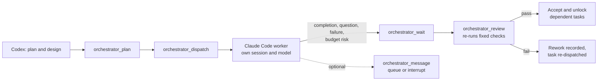

<div align="center">


# Codex Controls Claude

**Codex plans. Claude Code builds. Codex checks the work.**

A local Codex plugin that turns Claude Code into a supervised implementation worker: Codex designs the plan, dispatches bounded tasks to Claude Code with your own model, waits on real events instead of polling, and independently re-runs the acceptance checks before it unlocks anything downstream.

[Install](#install) · [How it works](#how-it-works) · [Tools](#tools) · [Permissions](#permissions-and-safety) · [Requirements](#requirements) · [Troubleshooting](#troubleshooting)

</div>

---

## Why this exists

Asking Codex to "write the code with Claude" usually means pasting a plan into a second terminal and hoping. Nothing tracks what was promised, nothing waits efficiently, and nothing verifies the result — you are the message bus, the scheduler and the reviewer at once.

This plugin moves those three jobs into a local MCP server that Codex drives directly:

| Without it | With Codex Controls Claude |
|---|---|
| You copy a plan into a Claude Code session and babysit it | Codex dispatches the task, the worker runs in its own session |
| You poll for "is it done?" | One event-triggered `orchestrator_wait`, woken by completion, questions, failures or budget risk |
| You decide whether the work is acceptable | Declared fixed checks are re-executed independently; failures record rework |
| Parallel work collides | Up to three executions with write-scope reservations and dependency DAGs |
| A stalled worker blocks everything | Queue guidance for the next turn boundary, or interrupt deliberately |

The plugin never implements, and it never accepts on vibes: acceptance is the original checks, run again.

## Install

Add the marketplace, then install the plugin:

```bash
codex plugin marketplace add Ultmebius/codex-controls-claude
codex plugin install codex-controls-claude@codex-controls-claude
```

Or browse plugins from the CLI plugin browser:

```bash
codex
```

Then run `/plugins`, open the **codex-controls-claude** marketplace tab and install the entry from there. Enable it, then restart the chat so the bundled MCP server loads. From a local checkout, point the marketplace at the folder instead:

```bash
codex plugin marketplace add ./codex-controls-claude
```

**Activation is explicit.** Invoke the plugin or its `orchestrate` skill — generic coding requests do not start a Claude Code worker. Authorized follow-ups continue the same run.

If anything looks wrong, ask for the setup skill, which runs `orchestrator_doctor` without printing credentials or invoking a model:

```bash
node scripts/doctor.mjs
```

## How it works

Codex stays the supervisor: it owns the goal, the design, scope changes, acceptance and session lifetime. Claude Code implements one bounded, independently verifiable stage at a time, using the model and tools you already configured.



A run carries its contract, dependencies, declared artifacts and immutable acceptance checks. The supervisor sees a compact result with explicit truncation markers; full blockers, errors, hashes and checks stay retrievable through `orchestrator_status` sections and targeted evidence. Changes are inventoried against the original task baseline, including untracked files, so an undeclared edit is visible rather than silently accepted.

### Parallel work

Codex can schedule one to three Claude Code workers at a time. Use an ordinary plan for a single worker; use `orchestrator_team` for independent parallel tasks:

- each task declares `dependsOn`, fixed checks, artifacts and literal `writeScope` paths;
- only accepted dependencies unlock downstream dispatch;
- three executions is a shared ceiling across all connected chats, ordinary runs and team children — a fourth is rejected with `WORKER_SLOTS_FULL` rather than queued indefinitely;
- write scopes are scheduling and audit contracts, not an OS sandbox. For potentially overlapping writes, use separate Git worktrees and integrate the accepted results explicitly.

Default budgets are 500 native agentic rounds per segment, 1000 SDK-reported turns per run or team, two hours per execution segment, and two acceptance repairs. Budget continuation, interruption recovery and acceptance rework use separate counters, and follow-ups never reset the budget.

### Two-way messages

A worker can reach Codex mid-task: `notify_supervisor` records an audited milestone, `ask_supervisor` asks for a decision, and both wake the pending wait. Codex answers inside the worker's original tool call.

Native `AskUserQuestion` travels the same channel. Codex receives the original questions and options as a `worker_question` and answers with `{"answers":{"<exact question text>":"<label or free text>"}}`; a single question also accepts plain text, and multi-select may send a JSON array of labels. A timeout, cancellation, stale ID or unparseable reply rejects the question explicitly, so the worker reports BLOCKED instead of guessing. Decisions expire after five minutes by default.

Guidance can also reach a worker through `orchestrator_message`:

- **`queue`** delivers exactly one input at the next native turn boundary, in FIFO order, with the follow-on segment reserved from the persistent turn budget first;
- **`interrupt`** additionally asks the runtime to end the current turn; the segment drains, then the message lands in the same saved conversation ahead of still-unsent queued messages.

Reported states are transport truth only — `queued`, `interruption_requested`, `delivering`, `delivered`, `failed`, `cancelled`. `delivered` never claims the model read the text; the worker's own visible reply is where it states what it understood.

### Recovery and continuity

Warm tasks reuse a live SDK session. After technical acceptance the candidate waits for your review; the supervisor keeps it for follow-up or closes it with its transcript preserved. Saved sessions resume on the next explicit task, idle review sessions suspend after 30 minutes, and `plan(action="attach", runId)` recovers after a connection loss without replaying model work. Original checks, revisions, dependencies and budgets survive recovery; stale owners are fenced out by unique identities and generations, and another chat can never take over a live run.

### Worker dashboard (Windows)

On Windows each execution is hosted in its own dedicated, minimized Windows Terminal with an independent dashboard: model, native permission mode, workspace, tools, review and failure status, elapsed runtime and effort. Each dashboard reports only its own session and never aggregates peer state. It is an event-driven view of the SDK session — it does not start a second Claude process or manufacture a native session, and closing it stops only that worker.

Effort is labelled configured unless authoritative native metadata confirms it; unconfirmed effort stays unknown. Native Windows additionally needs Windows Terminal and the .NET 10 runtime, because the packaged compiled helper owns transport and window control. On other platforms the worker runs over stdio.

## Tools

The bundled `claude-orchestrator` MCP server exposes ten tools:

| Tool | Purpose |
|---|---|
| `orchestrator_plan` | Create, continue, reconcile or attach to a run; owns the contract and its tasks |
| `orchestrator_dispatch` | Start dependency-ready work with a stable `requestId` |
| `orchestrator_wait` | One pending event promise, default and maximum 20 minutes |
| `orchestrator_review` | Re-run the original fixed checks and return the acceptance evidence |
| `orchestrator_status` | Targeted evidence sections: result, checks, artifacts, changes, executions, decisions, guidance, capabilities |
| `orchestrator_message` | Queue guidance, interrupt a turn, or reply to a `worker_question` |
| `orchestrator_respond_permission` | Answer a residual native permission request |
| `orchestrator_cancel` | Stop a run or a team task without disturbing peers |
| `orchestrator_team` | Create, dispatch, wait, review, approve or close a parallel team |
| `orchestrator_doctor` | Report local configuration health without credentials or model calls |

Waits are event-triggered, not polled: completion, questions, residual permissions, failures, budget risk and cancellation wake them immediately, while ordinary milestones stay in the audit trail. The packaged Codex compatibility projection declares `tool_timeout_sec=1260` so a full idle twenty-minute wait can reach the server.

## Permissions and safety

- **No tool is blocked.** Claude's built-ins, subagents, team tools and your enabled MCP servers all follow your own Claude Code settings, hooks and deny/ask rules.
- **Permission mode is inherited**, read from effective user/project/local `permissions.defaultMode`. Auto mode uses Claude's own classifier.
- **No file interception, no path rewriting, no PreToolUse veto.** Native residual ask inputs pass through unchanged.
- **No credentials are copied.** No Codex MCP configuration, gateway secret or token is bundled; your existing Claude Code authentication or gateway settings are used at runtime.
- **`writeScope` is advisory.** It is a scheduling and audit reservation; native permissions still govern access, and overlapping writes belong in separate worktrees.

The plugin does not measure token savings. It reduces unnecessary supervisor wakeups; it makes no benchmark claim.

## Requirements

| Requirement | Notes |
|---|---|
| Node.js 22+ | Runs the bundled MCP server |
| Claude Code | Installed locally and already authenticated (or gateway-configured) |
| Windows Terminal + .NET 10 runtime | Windows only, for the per-worker dashboard |
| Git Bash | Windows only, where a task needs POSIX tooling |

Model selection reads `env.ANTHROPIC_MODEL` from `~/.claude/settings.json` first, then the environment or top-level `model`, otherwise Claude Code's native default. The plugin never modifies your settings file. Warm sessions keep their startup model — close, resume or start a new session to apply a change.

### Configuration

| Variable | Default | Range |
|---|---|---|
| `CCC_CLAUDE_PATH` | resolved `claude` | Explicit Claude Code executable |
| `CCC_WAIT_MS` | 1200000 (20 min) | Lowers the default wait; the cap stays 20 min |
| `CCC_DECISION_TIMEOUT_MS` | 300000 (5 min) | 1s – 30 min |
| `CCC_INIT_TIMEOUT_MS` | 120000 | 1s – 10 min |
| `CCC_CHECK_TIMEOUT_MS` | 300000 | 1s – 10 min |
| `CCC_DATA_DIR` | `~/.local/share/codex-controls-claude` | State location; `PLUGIN_DATA` takes precedence |
| `CCC_NATIVE_HELPER` | packaged helper | Override the dashboard helper |

## Package layout

```
codex-controls-claude/
├── plugin.json                 Portable Agent Plugins manifest
├── .codex-plugin/plugin.json   Codex compatibility projection
├── mcp.json                    Portable MCP config
├── .mcp.json                   Codex projection with host timeouts
├── skills/
│   ├── setup/                  Onboarding and diagnostics
│   └── orchestrate/            Supervisor workflow + reference policy
├── server/
│   ├── index.mjs               Built MCP server (dependencies bundled)
│   ├── native/                 Compiled dashboard helper (Windows)
│   └── source/                 Maintained TypeScript and C# source subset
├── scripts/                    doctor.mjs, event-wait.mjs
└── assets/                     Plugin logo and composer icon
```

The server is shipped built, with the maintained source subset alongside it. Development checkout, dependency lock, test fixtures and reports stay in the surrounding workspace and are not part of this package.

## Troubleshooting

- **Tools don't appear** — confirm the plugin is enabled and its MCP launch succeeds, then reopen the chat. Run `node scripts/doctor.mjs`; a healthy report covers local configuration only, not real inference.
- **`healthy` but nothing executes** — verify with a live test in a disposable project: two dependency-linked tasks, a deliberately failing check, rework, then acceptance.
- **`WORKER_SLOTS_FULL`** — three executions are already active across your chats. Wait for an owned one to finish; retained idle transcripts consume no slot.
- **A wait returns empty** — that is a genuine idle timeout, not a signal to poll. Renew it with the same cursor.
- **New code isn't active** — new plugin code and startup instructions take effect on a fresh connection; running workers keep the version they loaded.

## Provenance and license

MIT. See [LICENSE](LICENSE).

Execution and session functionality derives from [xihuai18/claude-code-mcp](https://github.com/xihuai18/claude-code-mcp) (MIT, commit `47aa47b4`). The Codex task ledger, event subscriptions, independent acceptance gate, process ownership and plugin packaging are additions on top of it. See [UPSTREAM.md](UPSTREAM.md) and [THIRD_PARTY_NOTICES.md](THIRD_PARTY_NOTICES.md) for provenance and bundled license texts.

The worker policy inventory lives in [skills/orchestrate/references/worker-policy.md](skills/orchestrate/references/worker-policy.md).
